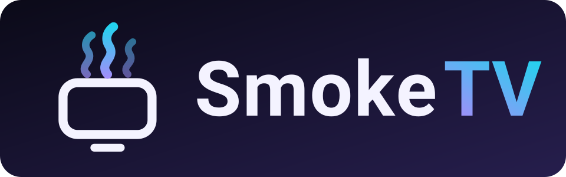
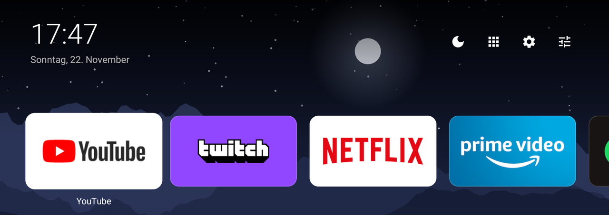
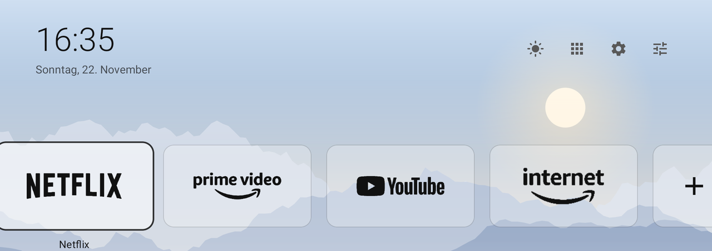
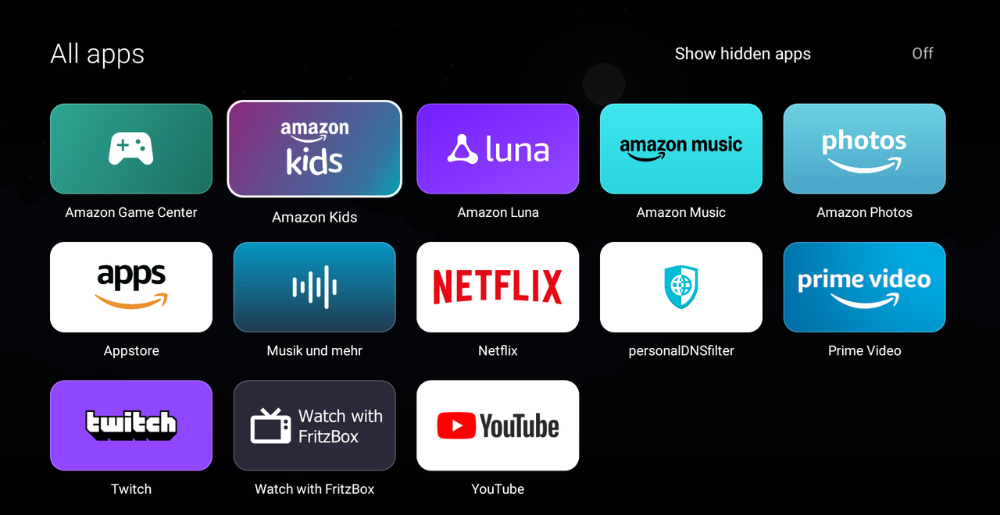

<p align="center">
  
</p>

<p align="center">
  <b>A 70&nbsp;KB home screen for the Amazon Fire TV Stick.</b><br>
  No ads. No carousel. No "sponsored" row. Just your apps, a sky full of stars, and the show you were watching.
</p>

<p align="center">
  
</p>

---

## Why

Amazon's home screen is a billboard that happens to have your apps somewhere on it.
SmokeTV replaces it with one calm row of the apps you actually use, a clock, and a mountain range
that drifts sideways as you move through the row.

It is written from scratch in plain Kotlin on the classic Android View system.
**Zero dependencies**: no AndroidX, no Leanback, no Compose, no Glide, no Retrofit.
The whole release APK, icons, wallpaper engine and web server included, is about **70 KB**.

| | |
|---|---|
|  |  |
| Light mode, logos in monochrome | All apps, every logo on its own colour |

## What it does

- **One row of pinned apps.** Big 16:9 tiles that grow on focus. Move, pin and unpin with the remote's Menu button (or a long press on OK).
- **Continue watching (Netflix).** The bottom row shows the episodes Netflix offers to continue, with their covers. Select one and it starts *that* episode.
- **Logos that look like they belong together.** Colour or monochrome, your choice.
- **A generated wallpaper.** Five layers of mountains under stars and a moon at night, or a pale dawn sky in light mode. Or a photo of your own, uploaded from your phone.
- **Dark and light mode** with one button in the top right.
- **Takes back the Home button.** Fire OS insists on Amazon's launcher. SmokeTV politely disagrees (see below).
- Weather in the status line (Open-Meteo, no API key), an app drawer that hides Amazon's system clutter, and a settings panel that fits on one screen.

## How it works (the fun part)

### 1. Taking the Home button back

Fire OS ignores third-party home apps. Press Home and Amazon's launcher comes up, no matter what you chose.
So SmokeTV doesn't fight the button, it *answers* it:

1. An optional **accessibility service** watches which window comes to the front. It only reacts to one class: `com.amazon.tv.launcher.ui.HomeActivity_vNext`. Amazon's settings live in the same package, so they stay reachable.
2. The moment Amazon's home appears, the service throws an **opaque black overlay** over it.
3. Android blocks app launches for **five seconds** after a Home press (the "app switch" protection). An **exact alarm** is sent by `system_server`, which is exempt, so SmokeTV launches itself through an alarm that fires *now* (`min_futurity=0`).
4. Android 11 only lets an app start an activity from the background if it has a visible window. The overlay *is* that window, so the launch waits for the overlay's first draw.
5. SmokeTV appears and the overlay disappears.

Honest footnote: Amazon's home is drawn *before* any app hears about it, so you may catch it for a frame or two. Hiding it completely would need system privileges no app gets.

### 2. "Continue watching" without an API

Fire OS has no Watch Next API for apps, and Netflix shares nothing with other launchers. **But** Netflix quietly posts invisible
*recommendation notifications* for Amazon's own home rows: group `continueWatching`, text `"Show, Episode"`, a 640×360 cover, and a
`PendingIntent` that opens exactly that episode. It refreshes them every time you leave the app.

SmokeTV's notification listener reads those cards and turns them into tiles. Nothing is shown to you as a notification and
nothing leaves the TV. (Prime Video was tested too: it posts no such cards, and its media session doesn't even report a title.)

### 3. Logos that look like a set

TV apps ship wildly different artwork. SmokeTV turns each one into a 16:9 tile:

- **TV banners** are used as they are.
- **Square icons** are rebuilt into banners. SmokeTV measures the icon's *plate*: four corner colours, verified along the whole edge, so gradients count too. It then lifts out everything that differs from the plate: that is the logo. The plate's colours are stretched over the tile and the logo goes in the middle, big.
- **Outlines don't fool it.** A logo is either lighter or darker than its plate; whatever sits on the other side (like Twitch's dark outline around white letters) is dropped, so letters don't melt into a blob.
- **Wide icons** (Amazon Kids and Photos ship a 16:9 picture *as their icon*) are recognised and used as banners instead of being squashed into a square.
- Icons are loaded at **xxxhdpi** and adaptive icons are drawn **uncropped**. Fire OS shows banners, not icons, so many TV wordmarks ignore Android's safe zone.
- **Monochrome mode** uses the same lifted logo as a white (or black) mask.
- Amazon ships some apps only as 30 KB **stubs** that download the real app on first launch (Silk, miniTV). They aren't installed, so SmokeTV hides them.

### 4. Mountains made of maths

The wallpaper is five ridgelines made with **midpoint displacement**: rough, jagged peaks far away, gentle hills up front,
and a little haze at the foot of each far layer. Fixed seeds, so it's the same range every time. The paths are built once.
A frame only *translates* them, at five different speeds, as your focus moves along the row: cheap parallax, even on a Stick.

### 5. A wallpaper from your phone, no cloud

*Upload wallpaper from phone* starts a tiny HTTP server on the TV (a raw `ServerSocket`, about 150 lines) and shows its
address. Open it on your phone, pick a photo, and the page downsizes it **in your browser** to 1080p before sending it.
The server checks it really is an image, swaps the wallpaper, and shuts down when you close the panel.

### 6. Fitting in 70 KB

Framework views only, `SharedPreferences`, `HttpURLConnection`, `org.json`, `LruCache`, vector drawables, and R8 with resource shrinking.
The Kotlin standard library is the only thing that isn't Android, and R8 trims it down to the few functions actually used.

## Install

You need a PC with the Android SDK platform tools (`adb`) and a JDK 17+.

On the Fire TV: *Settings › My Fire TV › Developer options › ADB debugging: On*. The IP address is under *About › Network*.

```bash
git clone https://github.com/Florent777/SmokeTV && cd SmokeTV
./gradlew assembleRelease            # Windows: .\gradlew.bat assembleRelease

adb connect <fire-tv-ip>:5555        # accept the prompt on the TV
adb install -r app/build/outputs/apk/release/app-release.apk
adb shell am start -n io.github.florent777.smoketv/.MainActivity
```

Or grab the APK from [Releases](../../releases) and skip the build.

### Make it *the* home screen (optional)

```bash
P=io.github.florent777.smoketv
adb shell settings put secure enabled_accessibility_services $P/$P.HomeRedirectService
adb shell settings put secure accessibility_enabled 1
adb shell settings put global alarm_manager_constants min_futurity=0    # instant, instead of ~5 s
```

`enabled_accessibility_services` is a list; the line above replaces it.
Turn it off again with `adb shell settings put secure enabled_accessibility_services '""'`.

### Continue watching (optional)

```bash
adb shell cmd notification allow_listener io.github.florent777.smoketv/io.github.florent777.smoketv.WatchListener
```

After updating the APK, run the accessibility and listener lines again: Fire OS unbinds both on an update.

## Using it

| Remote | Does |
|---|---|
| D-pad | Move. Up from the row reaches the buttons in the top right. |
| OK | Open |
| Menu (≡) or hold OK | Move left/right, pin/unpin, hide from the drawer, app info |
| Back | Closes whatever is open; never drops you on Amazon's screen |

**Top right:** dark/light mode · all apps · Fire TV settings · SmokeTV settings
(icon style, edge dimming, recent episodes row, weather, wallpaper, continue watching, Home redirect status).

## Limits, honestly

- Continue watching works with **Netflix only**: it's the only app on Fire OS that leaves these cards for other launchers. It shows the last two shows, without a progress bar (Netflix sends 0).
- The Home redirect can show Amazon's screen for a frame (see above).
- Tested on a Fire TV Stick with Fire OS 7 (Android 9). Fire OS 8 (Android 11) is targeted and accounted for, but less tested.
- The release APK in Releases is signed with a debug key. Build it yourself if you want your own signature.

## Project layout

```
app/src/main/java/io/github/florent777/smoketv/
├─ MainActivity.kt         the screen: rows, focus wiring, drawer, menus, settings, upload panel
├─ AppRepository.kt        app discovery, stub filter, logo extraction, banner building, icon cache
├─ TileView.kt             the tile: glass card, focus animation, cover and caption
├─ MountainView.kt         the generated parallax wallpaper
├─ HomeRedirectService.kt  the Home-button takeover (accessibility service)
├─ WatchListener.kt        Netflix continue-watching cards (notification listener)
├─ WallpaperServer.kt      the tiny upload server
├─ Weather.kt, Prefs.kt, Ui.kt, BootReceiver.kt
```

## Credits

- The Fire OS home-takeover tricks (alarm launch, cover window, Amazon's home activity name) were learned from
  [dumbtv](https://github.com/humblemuzzu/dumbtv) (MIT). SmokeTV's code is its own.
- Weather by [Open-Meteo](https://open-meteo.com).
- Logo wordmark from Roboto Bold; UI icons and the game controller from Material Icons (both Apache 2.0).

## License

MIT, see [LICENSE](LICENSE).
